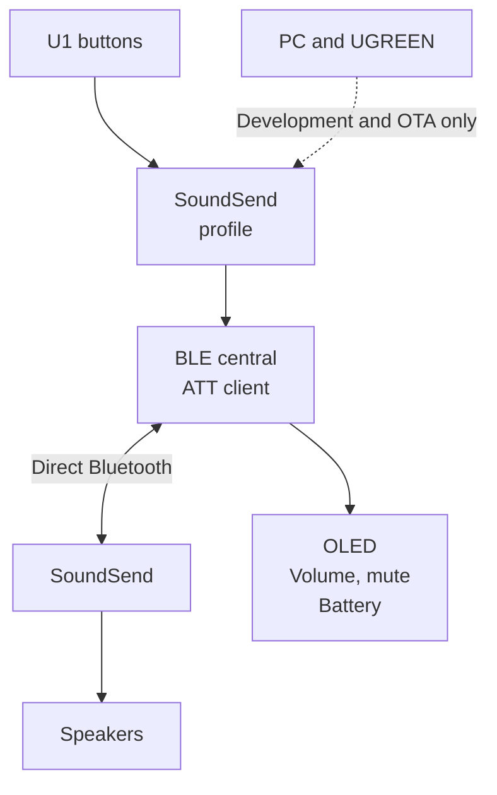

# SofaBaton U1 → WiSA SoundSend

Direct Bluetooth volume and mute control from a SofaBaton U1 remote to a WiSA SoundSend transmitter, without a computer, phone, hub, or bridge during everyday use.

This repository contains a Cortex-M0 firmware extension for U1 hardware revision 3, Windows development tools, ARM emulation tests, and protocol and validation documentation.

## The problem

When HDMI-CEC volume control is unavailable, the SoundSend app remains a working control interface, but it does not provide physical remote buttons. Direct control from the U1 requires a Bluetooth central that implements SoundSend's GATT protocol: service discovery, notification subscription, volume queries, and volume writes. A conventional Bluetooth remote-control key mapping does not provide those operations.

## The solution

The U1 firmware extension implements a small BLE central, a SoundSend ATT client, and hooks into the remote's key and display routines. Selecting the dedicated **SoundSend** profile activates this control path. The extension reads the actual volume, sends a bounded change, and shows the value confirmed by the transmitter.

Only the **U1 firmware** is modified. SoundSend retains its original firmware. Bluetooth carries control messages here, not the audio stream.

## Current status

**LAB19 / TMRJ is installed; its actual boot was verified on 2026-10-27 at 16:42:40 UTC.** All 7,936 transfer blocks were acknowledged. The installed candidate passed **134 offline tests** and corrects a delayed-response case that reproduced LAB18's failed held-volume test.

Hardware snapshots confirmed that the inactivity counter continued advancing after radio release. The first read-only SoundSend query failed to establish a working link. A subsequent PC connection to the U1 timed out, leaving final button reactivation after the diagnostic and physical behavior checks pending. The controls enable automatically on a full boot. The vendor application reports version 32 for this V32-based extension; custom diagnostics identify revision 19.

| Capability | Evidence |
| --- | --- |
| Direct U1 → SoundSend volume changes | Confirmed through manual testing on earlier installed revisions |
| One volume step per physical press | Implemented and ARM-tested; up/down operation confirmed through manual testing |
| Dedicated SoundSend profile | Read back from the remote; other profiles preserved |
| Stable volume screen without profile-menu flash | LAB16 correction confirmed through manual testing |
| Native inactivity timer after Bluetooth use | Verified advancing on hardware; automatic screen-off confirmation pending |
| Gradual volume repetition while held | LAB19 installed and offline-tested; physical confirmation pending |
| Mute and restore previous volume | Implemented and emulation-tested; physical button confirmation pending |
| Earlier display update and battery percentage | Implemented and tested; physical display confirmation pending |
| Controls enabled after boot | Verified in the actual LAB19 post-update boot; final reactivation after diagnostics pending |
| Offline validation | **134 tests passed** for installed LAB19 across seven suites |

See [validation and installation evidence](docs/validation.md) for exact hashes, limits, and outstanding checks. Test success is not a claim of universal hardware compatibility or proven recovery.

## Controls

Select the **SoundSend** profile on the U1 and keep the transmitter powered.

The hold behavior below describes the installed LAB19 implementation and still requires physical confirmation.

| Button | Action |
| --- | --- |
| Volume up | Increase actual volume by one, up to 100 |
| Volume down | Decrease actual volume by one, down to 0 |
| Mute | Read the actual level, remember it, and set volume to 0 |
| Mute again | Restore the remembered level if the actual level is still 0 |

Holding a volume key repeats gradually after an initial delay. Repeats are paced at least 120 ms apart and require confirmation of the previous operation, preventing a backlog while connecting. Releasing the key stops further repeats; a write already in flight may still complete. Mute toggles once per press.

Volume keys leave mute starting from the actual zero level. A different controller's intervening volume change is read before the next operation. The remembered mute level survives normal retained sleep, but not battery removal or a full reset. The installed OLED volume label is `Volumen`; repository documentation is English.

## Repository guide

| Location | Purpose |
| --- | --- |
| [docs/problem-and-solution.md](docs/problem-and-solution.md) | Requirements, investigation, and design decisions |
| [docs/architecture.md](docs/architecture.md) | Firmware modules, timing, memory, and integration |
| [docs/power-management.md](docs/power-management.md) | Inactivity timer regression, sleep restoration, and volume hold behavior |
| [docs/protocol.md](docs/protocol.md) | Verified SoundSend messages and U1 controls |
| [docs/build-and-test.md](docs/build-and-test.md) | Offline build setup and test reproduction |
| [docs/installation.md](docs/installation.md) | Unit-specific OTA workflow and constraints |
| [docs/validation.md](docs/validation.md) | Recorded results and remaining physical checks |
| [CHANGELOG.md](CHANGELOG.md) | Key experimental revisions |
| [firmware/](firmware/) | C, Thumb assembly, linker scripts, builders, and ARM tests |
| `u1_*.py`, `ble_probe.py` | Windows installation, identification, and diagnostic tools |
| [fixtures/](fixtures/) | Minimal protocol-only test transcript |
| [scripts/](scripts/) | Local preparation and prerequisite checks |
| [NOTICES.md](NOTICES.md) | References, provenance, and excluded vendor artifacts |

The host scripts remain at the repository root because their imports and artifact paths depend on that layout. Raw captures, machine-specific state, credentials, vendor binaries, generated firmware, and toolchains are excluded from Git.

## Scope

This is a version-specific research implementation, not a generic U1 update. The physical unit originally ran firmware 33; the available patch base is the vendor's V32 image. An exact FW33 backup and a tested recovery procedure are unavailable. The code contains guards for the studied unit, profile, adapter, base hash, and installed state. A fresh clone can support offline reproduction after supplying the required local assets; it is deliberately insufficient for an unattended flash of another remote.
