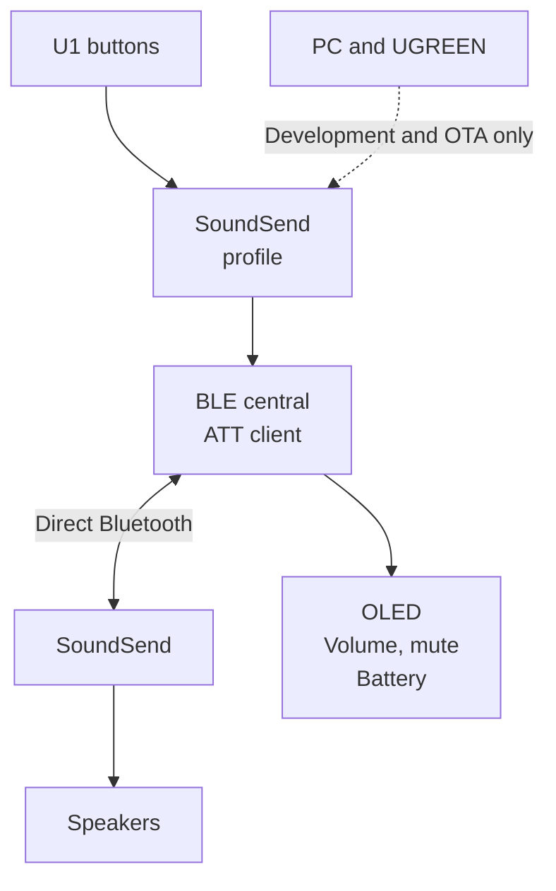
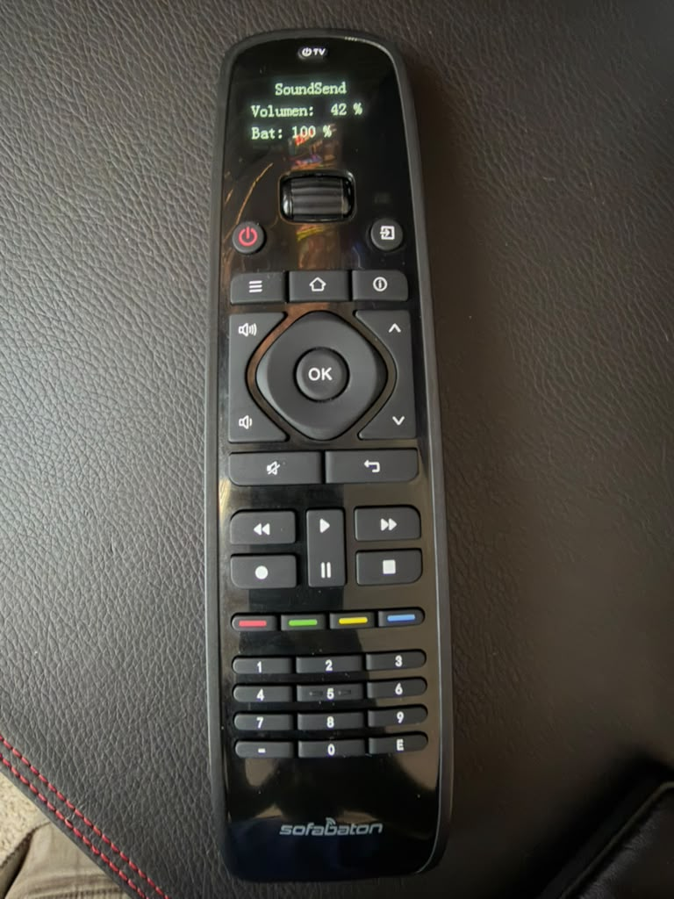
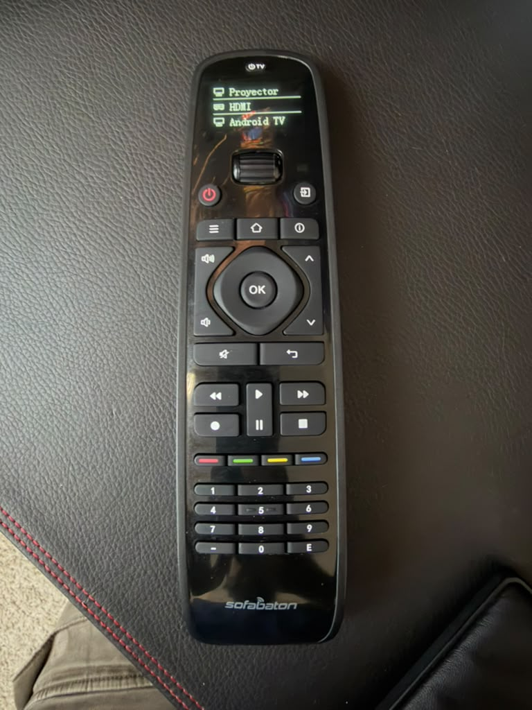
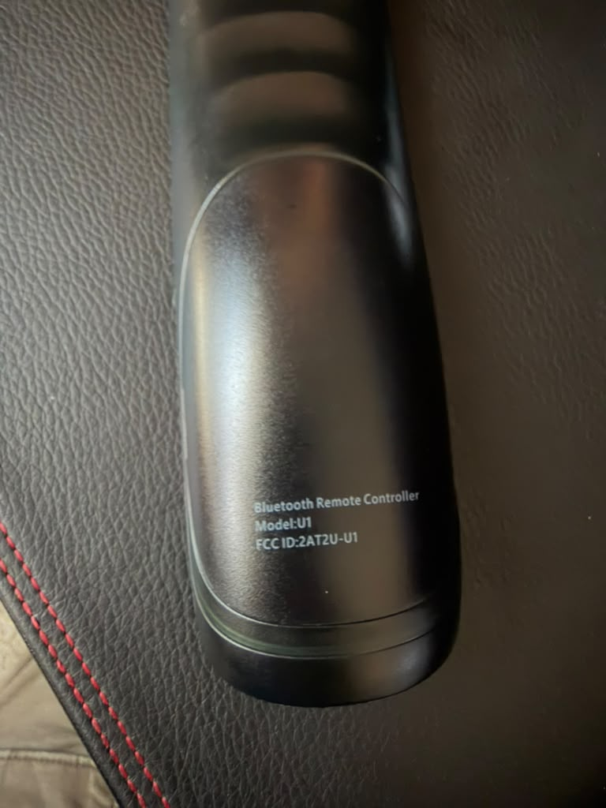

# SofaBaton U1 → WiSA SoundSend

Direct Bluetooth volume and mute control from a SofaBaton U1 remote to a WiSA SoundSend transmitter, without a computer, phone, hub, or bridge during everyday use.

This repository contains a Cortex-M0 firmware extension for U1 hardware revision 3, Windows development tools, ARM emulation tests, and protocol and validation documentation.

## The problem

When HDMI-CEC volume control is unavailable, the SoundSend app remains a working control interface, but it does not provide physical remote buttons. Direct control from the U1 requires a Bluetooth central that implements SoundSend's GATT protocol: service discovery, notification subscription, volume queries, and volume writes. A conventional Bluetooth remote-control key mapping does not provide those operations.

## The solution

The U1 firmware extension implements a small BLE central, a SoundSend ATT client, and hooks into the remote's key and display routines. Selecting the dedicated **SoundSend** profile activates this control path. The extension reads the actual volume, sends a bounded change, and shows the value confirmed by the transmitter.

Only the **U1 firmware** is modified. SoundSend retains its original firmware. Bluetooth carries control messages here, not the audio stream.

## Hardware photos

<table>
  <tr>
    <td align="center"></td>
    <td align="center"></td>
    <td align="center"></td>
  </tr>
  <tr>
    <td><strong>SoundSend view.</strong> Displayed volume: 42%; displayed battery: 100%.</td>
    <td><strong>Native profile menu.</strong> The other profiles remain available in the original interface.</td>
    <td><strong>Hardware identification.</strong> Model U1, FCC ID 2AT2U-U1.</td>
  </tr>
</table>

Click a photo to open the original image. These LAB19 photographs predate the link indicator added in LAB20. The battery value is the native estimator's reading.

## Current status

**LAB20 / TMRK is installed; its actual boot was verified on 2026-10-27 at 19:44:04 UTC.** All 7,936 transfer blocks were acknowledged. The exact package passed **139 offline tests** and installer preflight. All five profile records were read back unchanged, including the new Fire TV profile. Physical switching confirmation is pending.

Earlier manual feedback accepted LAB19 for SoundSend use. After adding a new Fire TV profile through the app, a separate failure was reported: Fire TV worked, but returning to SoundSend left a cached percentage without working volume commands. A fresh read confirmed all five profiles, including the new Fire TV profile at slot 5. LAB20's correction is installed and validated offline; repeated physical transitions remain to be tested.

LAB19's actual boot was verified on 2026-10-27 at 16:42:40 UTC after 7,936 acknowledged transfer blocks. Hardware snapshots confirmed that the inactivity counter continued advancing after radio release. Controls enable automatically on a full boot. The vendor application reports version 32 for this V32-based extension; custom diagnostics distinguish LAB revisions. Historical diagnostics and manual feedback remain in the validation record.

| Capability | Evidence |
| --- | --- |
| Direct U1 → SoundSend volume changes | Confirmed through manual testing on earlier installed revisions |
| One volume step per physical press | Implemented and ARM-tested; up/down operation confirmed through manual testing |
| Dedicated SoundSend profile | Read back from the remote; other profiles preserved |
| Fire TV and SoundSend switching | LAB19 failure reported; LAB20 correction installed and ARM-tested; physical switching confirmation pending |
| Stable volume screen without profile-menu flash | LAB16 correction confirmed through manual testing |
| Native inactivity timer after Bluetooth use | Verified advancing on hardware; native sleep path covered offline |
| Gradual volume repetition while held | LAB19 delayed-response correction tested offline; subsequent overall manual acceptance recorded |
| Mute and restore previous volume | Implemented and emulation-tested; no separate manual mute/restore checklist recorded |
| Volume and battery display | Photographed on the physical remote; no instrumented display-latency measurement |
| Controls enabled after boot | Verified in the actual LAB20 post-update boot and again before configuration disconnect |
| Offline validation | **139 tests passed** for installed LAB20 across seven suites |

See [validation and installation evidence](docs/validation.md) for exact hashes, manual feedback, and measurement limits. Test success is not a claim of universal hardware compatibility or proven recovery.

## Connection and everyday use

Turn on the projector so that SoundSend has power, select **SoundSend** on the U1, and use the volume or mute buttons. No pairing step, phone, or PC is required for normal use. Disconnect any active U1 configuration session first.

The installed firmware targets SoundSend address `CC:90:93:18:93:0A`. A button press starts a direct connection; the link closes after a short idle interval and the next press connects again. The target survives battery replacement because it is compiled into the firmware. There is currently no menu for choosing a different SoundSend: changing transmitters requires verifying the replacement device and rebuilding and installing the U1 extension with its address.

See [connection, reconnection, and changing devices](docs/connection-and-devices.md) for the complete procedure, including the difference between configuration pairing and normal control.

## Controls

Select the **SoundSend** profile on the U1 and keep the transmitter powered.

The button behavior below is retained in LAB20. Its new native Bluetooth handoff and link indicator still require physical switching confirmation.

| Button | Action |
| --- | --- |
| Volume up | Increase actual volume by one, up to 100 |
| Volume down | Decrease actual volume by one, down to 0 |
| Mute | Read the actual level, remember it, and set volume to 0 |
| Mute again | Restore the remembered level if the actual level is still 0 |

Holding a volume key repeats gradually after an initial delay. Repeats are paced at least 120 ms apart and require confirmation of the previous operation, preventing a backlog while connecting. Releasing the key stops further repeats; a write already in flight may still complete. Mute toggles once per press.

Volume keys leave mute starting from the actual zero level. A different controller's intervening volume change is read before the next operation. The remembered mute level survives normal retained sleep, but not battery removal or a full reset. The installed OLED volume label is `Volumen`; repository documentation is English.

LAB20 adds a top-right link indicator: `...` while connecting, `BT` after receiving a valid volume on the active session, `!` after an error, and blank while idle. The displayed percentage remains the last confirmed value. Because the link closes when idle, the `BT` indicator normally disappears after use. See [Bluetooth profile handoff](docs/bluetooth-profile-handoff.md) for the Fire TV-to-SoundSend correction and its validation scope.

## Repository guide

| Location | Purpose |
| --- | --- |
| [docs/connection-and-devices.md](docs/connection-and-devices.md) | Everyday connection, reconnection, pairing, and using another transmitter or remote |
| [docs/bluetooth-profile-handoff.md](docs/bluetooth-profile-handoff.md) | Native Bluetooth reconnection race, Fire TV switching, and the live-link indicator |
| [docs/problem-and-solution.md](docs/problem-and-solution.md) | Requirements, investigation, and design decisions |
| [docs/architecture.md](docs/architecture.md) | Firmware modules, timing, memory, and integration |
| [docs/power-management.md](docs/power-management.md) | Inactivity timer regression, sleep restoration, and volume hold behavior |
| [docs/protocol.md](docs/protocol.md) | Verified SoundSend messages and U1 controls |
| [docs/build-and-test.md](docs/build-and-test.md) | Offline build setup and test reproduction |
| [docs/installation.md](docs/installation.md) | Unit-specific OTA workflow and constraints |
| [docs/validation.md](docs/validation.md) | Recorded results, hardware photos, manual acceptance, and evidence limits |
| [CHANGELOG.md](CHANGELOG.md) | Key experimental revisions |
| [firmware/](firmware/) | C, Thumb assembly, linker scripts, builders, and ARM tests |
| `u1_*.py`, `ble_probe.py` | Windows installation, identification, and diagnostic tools |
| [fixtures/](fixtures/) | Minimal protocol-only test transcript |
| [scripts/](scripts/) | Local preparation and prerequisite checks |
| [NOTICES.md](NOTICES.md) | References, provenance, and excluded vendor artifacts |

The host scripts remain at the repository root because their imports and artifact paths depend on that layout. Raw captures, machine-specific state, credentials, vendor binaries, generated firmware, and toolchains are excluded from Git.

## Scope

This is a version-specific research implementation, not a generic U1 update. The physical unit originally ran firmware 33; the available patch base is the vendor's V32 image. An exact FW33 backup and a tested recovery procedure are unavailable. The code contains guards for the studied unit, profile, adapter, base hash, and installed state. A fresh clone can support offline reproduction after supplying the required local assets; it is deliberately insufficient for an unattended flash of another remote.
