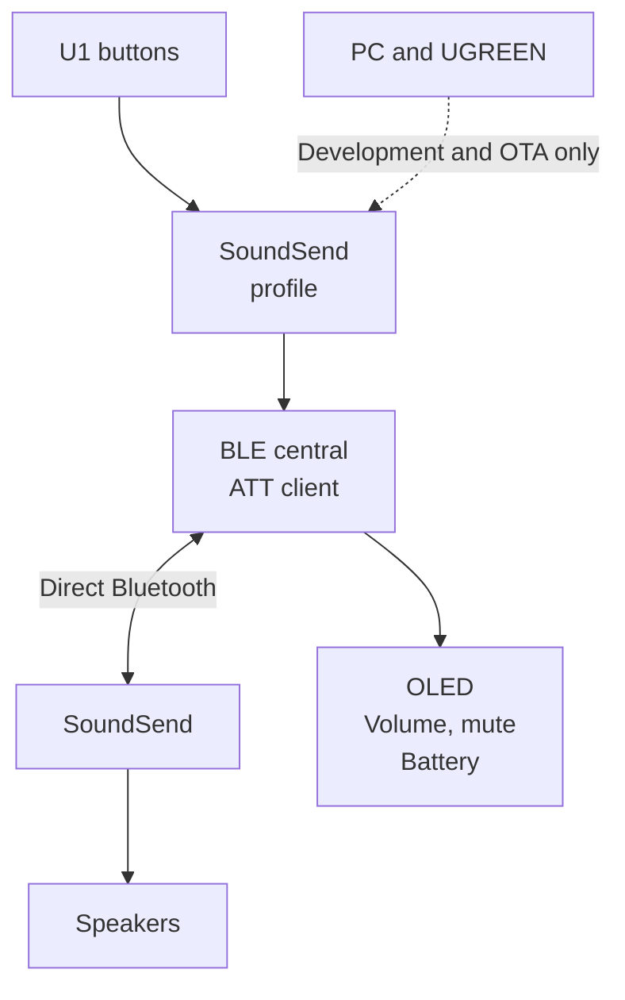

# SofaBaton U1 → WiSA SoundSend

Direct Bluetooth volume control from a SofaBaton U1 remote to a WiSA SoundSend transmitter, without a computer, phone, hub, or bridge during everyday use.

This repository documents an experiment on an owned U1 hardware revision 3 unit. It includes the Cortex-M0 firmware extension, Windows development tools, ARM emulation tests, and the evidence behind the implementation.

## The problem

The SoundSend volume was controllable through its iPhone app, but the projector's HDMI-CEC volume control did not work. The owner wanted to use the U1's physical volume and mute buttons directly. Both devices having Bluetooth was insufficient: the remote needed to initiate the SoundSend control protocol, rather than send an ordinary remote-control key code.

## The solution

The U1 firmware was extended with a small BLE central, a SoundSend ATT client, and hooks into the remote's key and display routines. A dedicated **SoundSend** profile replaces the former Fire TV profile. The extension reads the actual volume, sends a bounded change, and shows the value confirmed by the transmitter.

Only the **U1 firmware** is modified. SoundSend retains its original firmware. Bluetooth carries control messages here, not the audio stream.

## Current status

**LAB17 / TMRH was installed and its actual boot verified on 2026-10-27 at 05:07:36 UTC.** It starts with the dedicated controls enabled and the previously verified radio configuration. The vendor application still identifies the underlying firmware as version 32; custom diagnostics identify revision 17.

| Capability | Evidence |
| --- | --- |
| Direct U1 → SoundSend volume changes | Confirmed by the owner on earlier installed revisions |
| One volume step per physical press | Implemented and ARM-tested; owner confirmed up/down operation |
| Dedicated SoundSend profile | Read back from the remote; other profiles preserved |
| Stable volume screen without profile-menu flash | Owner confirmed LAB16 correction |
| Mute and restore previous volume | Implemented and emulation-tested in LAB17; physical button confirmation pending |
| Earlier display update and battery percentage | Implemented and tested in LAB17; physical display confirmation pending |
| Controls enabled after boot | Verified in the actual LAB17 post-update boot |
| Offline validation | **123 tests passed** across seven suites |

See [validation and installation evidence](docs/validation.md) for exact hashes, limits, and outstanding checks. Test success is not a claim of universal hardware compatibility or proven recovery.

## Controls

Select the **SoundSend** profile on the U1 and keep the transmitter powered.

| Button | Action |
| --- | --- |
| Volume up | Increase actual volume by one, up to 100 |
| Volume down | Decrease actual volume by one, down to 0 |
| Mute | Read the actual level, remember it, and set volume to 0 |
| Mute again | Restore the remembered level if the actual level is still 0 |

A held button counts once until released. Volume keys leave mute starting from the actual zero level. A different controller's intervening volume change is read before the next operation. The remembered mute level survives normal retained sleep, but not battery removal or a full reset. The on-device labels retain the owner's existing language; repository documentation is English.

## Repository guide

| Location | Purpose |
| --- | --- |
| [docs/problem-and-solution.md](docs/problem-and-solution.md) | Requirements, investigation, and design decisions |
| [docs/architecture.md](docs/architecture.md) | Firmware modules, timing, memory, and integration |
| [docs/protocol.md](docs/protocol.md) | Verified SoundSend messages and U1 controls |
| [docs/build-and-test.md](docs/build-and-test.md) | Offline build setup and test reproduction |
| [docs/installation.md](docs/installation.md) | Unit-specific OTA workflow and constraints |
| [docs/validation.md](docs/validation.md) | Recorded results and remaining physical checks |
| [CHANGELOG.md](CHANGELOG.md) | Key experimental revisions |
| [firmware/](firmware/) | C, Thumb assembly, linker scripts, builders, and ARM tests |
| `u1_*.py`, `ble_probe.py` | Windows installation, identification, and diagnostic tools |
| [fixtures/](fixtures/) | Minimal protocol-only test transcript |
| [scripts/](scripts/) | Local preparation and prerequisite checks |
| [NOTICES.md](NOTICES.md) | References, provenance, and excluded vendor artifacts |

The host scripts remain at the repository root because their imports and artifact paths depend on that layout. Raw captures, machine-specific state, credentials, vendor binaries, generated firmware, and toolchains are excluded from Git.

## Scope

This is a version-specific research implementation, not a generic U1 update. The physical unit originally ran firmware 33; the available patch base is the vendor's V32 image. An exact FW33 backup and a tested recovery procedure are unavailable. The code contains guards for the studied unit, profile, adapter, base hash, and installed state. A fresh clone can support offline reproduction after supplying the required local assets; it is deliberately insufficient for an unattended flash of another remote.
