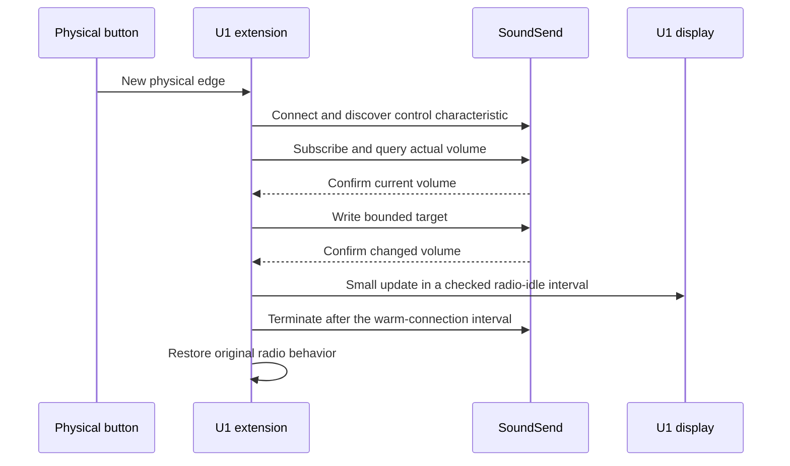

# Architecture

## Firmware layers

| Module | Responsibility |
| --- | --- |
| `soundsend_client.c` | ATT discovery, CCCD subscription, fragmented notification parsing, volume read/write, queued changes, and timeouts |
| `ble_central.c` | Legacy LE 1M central, CSA#1 channel hopping, connection events, SN/NESN handling, L2CAP, and graceful termination |
| `ble_packet.c` | BLE CRC, whitening, and packet encoding |
| `a8107_port.c` | A8107M0 MMIO radio and timer access, bounded waits, acquisition, and restoration |
| `u1_integration.c` | Dedicated-profile selection, button edges, mute state, display updates, battery value, and bounded diagnostics |
| `u1_trampolines.S` | Thumb entry hooks preserving the original firmware calling conventions |

The original firmware retains its other profiles, native key behavior, configuration connection, and OTA handler. The extension consumes volume-up, volume-down, and mute only when the named dedicated profile is selected and neither configuration nor a native pairing screen owns the remote.

## Operation

The connection interval is 30 ms. The warm interval is bounded to 800 ms, allowing successive presses to reuse service discovery and subscription. LAB19 restarts that interval when discovery or a write is confirmed, as well as when a new key operation is accepted. A slow response therefore cannot cause the newly ready connection to close in the same poll. Confirmed display updates run before disconnect; the connection is not kept open indefinitely.

LAB20 ends the previous native HID retry policy before requesting an asynchronous disconnect. This prevents the native main loop from repeatedly restarting the Fire TV advertiser while SoundSend waits to acquire the radio. The existing HID key path remains available for the next Fire TV operation. See [Bluetooth profile handoff](bluetooth-profile-handoff.md) for the original ARM control flow and regression coverage.

A physical volume-key edge requests one step. A held volume key can repeat after a 400 ms initial ready interval, then at intervals of at least 120 ms after confirmation. Repetition requires an active connection and `SS_READY`, so a slow or unavailable peer cannot accumulate a backlog of timed repeats. Mute remains edge-triggered. Releasing the key stops repeat callbacks; an already transmitted write may still complete.

## Display timing

Full screen rendering and ADC battery reads stay outside active radio ownership. During a connection, a partial update is allowed only when:

- The SoundSend view is valid and selected.
- The central is between connection events.
- No launch action, armed receiver, or receive lock is pending.
- At least 12 ms remains before the next connection anchor.

One poll draws at most one field: three connection-indicator characters, three volume digits, or four mute-indicator characters. It checks the time again on a later poll before drawing another field. The connecting indicator is also drawn before radio acquisition. Native-renderer instruction-count tests and injected display delays exercise the budget; they do not substitute for physical timing measurement.

The existing screen gateway bypasses the native device-list renderer for a valid SoundSend selection. Other profiles, selection repair, and the native low-battery screen retain their original paths.

## Memory and sleep

The extension occupies 424 bytes of retained lower SRAM, from `0x200039D8` to `0x20003B80`. Its stack limit is `0x20003B80`, with top `0x20003FF0`. The upper LCD SRAM bank is not retained in the studied sleep modes and must not hold live protocol or mute state.

Tests overwrite the upper bank to verify preservation of volume control and the remembered mute level. Complete battery removal resets runtime state, including the remembered level and last-known volume.

The native inactivity counter uses LPTIMER1, which is separate from the 16 MHz Timer1 used for BLE scheduling. LAB18 keeps the inactivity peripheral running while temporarily masking its interrupt during radio ownership. Release restores the previous interrupt enable state and preserves a pending inactivity interrupt. The stock timeout and sleep routines then resume, including after selection of another profile. See [power management](power-management.md) for the LAB17 regression and its validation.

## Boot defaults and configuration

LAB20 retains the enabled boot default with TX mode 10, RX-clear mode 2, and a 72 µs TX lead. These are the settings previously used for successful physical control. Unknown volume starts as `---`; no guessed percentage is shown. A cached percentage is separate from the active-session indicator.

Diagnostic commands use a bounded 20-byte FFF4/FFF3 exchange. They do not provide arbitrary memory access. OTA preparation still requires disabled, idle control. Post-update verification checks the actual revision, build identifier, enabled state, and radio defaults before recording a successful installation.
